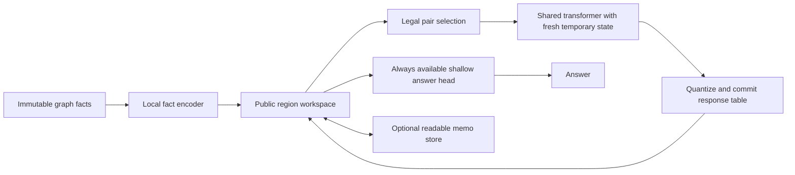

> Supplied by the user on 2026-10-01 ("try this out"). External proposal, speculative, not yet registered. Pipeline: Literature novelty check → THEORY registration of Phase A → Experiments implements and runs.

**Coconut with compositional boundary memory**

Detailed architecture and experimental proposal · Version 0.1 · October 1, 2026

**Status:** speculative research design. No implementation, training run, benchmark result, or guarantee of novelty is claimed. This proposal builds on the project results supplied by the user and the preceding architecture discussion.

**1. Decision and central hypothesis**

Build a latent reasoner whose persistent state is a collection of small, explicitly defined interfaces. A shared transformer learns to combine those interfaces. Each invocation uses fresh temporary activations; the interface it produces is the only numerical information carried into the next computation.

For graph reachability, an interface describes how a region responds to different activations of its boundary nodes. The model therefore stores what the region does to its surroundings. A region containing one edge and a region containing twenty edges can have the same interface.

The central hypothesis is:

> If future computation depends on a sufficiently grounded response interface, semantically equivalent regions should remain interchangeable despite different construction histories. This should reduce the usefulness of a learned execution-age deadline and permit additional composition beyond the training horizon.

The hypothesis is stronger than successful text serialization and weaker than a theorem about arbitrary neural reasoning. A small numerical table can still encode age. A controller can still learn a deadline. Approximate compositions can still accumulate errors. Those possibilities define the main interventions and falsifiers below.

The first deliverable should be a two-layer, d=256 prototype with fixed-budget evaluation. Learned routing, halting, writing, and a GPT-2 version follow only after the composition mechanism passes its initial tests.

**2. Motivation from the supplied project evidence**

The project reports that its toy Coconut-style models conduct a frontier sweep, but failing seeds switch behavior at a learned training-depth horizon. Thought content, attention-history length, and a step clock can expose execution age. Fine-tuning rarely repairs the established circuit. Re-anchoring into short segments succeeds much more often, and distilling re-anchored answers can extend the single-loop model.

This proposal interprets those results as evidence that a familiar entry representation may allow useful computation to resume. It changes the object being propagated: every committed thought is a reusable interface rather than an unrestricted vector carrying the history of its construction.

That interpretation remains provisional. Better or deeper teacher targets could explain part of the distillation result. The architecture must therefore earn its mechanism claim through matched-semantics, different-history interventions, rather than through higher final accuracy alone.

The supplied findings are accepted as project premises; they were not independently reproduced while preparing this document.

**3. Scope and non-negotiable constraints**

The initial domain is directed graph reachability on branch-and-decoy DAGs. Cyclic graphs are a subsequent evaluation because composing regions with feedback may be harder to learn. Graph size, input length, and decoy statistics should remain controlled across depth splits.

The initial interface cap is four boundary nodes. The prototype supports only executions whose selected contractions respect this cap. It must report illegal merges and blocked executions explicitly. A graph admitting a good decomposition does not imply that an arbitrary schedule will find it.

The following constraints define the proposed model:

- No unrestricted persistent thought vector accompanies the response tables.
- No latent KV history survives between worker calls.
- The worker does not receive elapsed step, construction depth, region size, or a creation-order identifier.
- The runtime performs graph bookkeeping, not reachability closure or correct table composition.
- The answer head has the same kind of access at every budget, including zero merges.
- All persistent state that can influence future behavior is included in the language round trip.
- Training uses terminal task answers, terminal reward, and label-free consistency; no intermediate frontier or true region-table targets are supplied in the main condition.

These restrictions reduce obvious private channels. They do not prove that age is absent: table values, the available candidate set, and workspace structure can still reveal it.

**4. Mathematical state definition**

Let the immutable task input be a directed graph G=(V,E) and a declared pinned-terminal set P. For ordinary reachability, P={r,q}, where r is the root and q is the query. An independent boundary-probe task may pin up to four named terminals. A region R owns an edge subset E_R. Active regions partition the edges: their edge sets are disjoint, although they may share vertices.

Let V_R be the vertices incident to edges in E_R. Define the region boundary as:

\[
B_R = \{v\in V_R:\text{some incoming or outgoing edge incident to }v\text{ lies in }E\setminus E_R\}
\;\cup\; (P\cap V_R).
\]

Both incoming and outgoing external incidence matter. A contained pinned terminal remains a boundary port even when it would otherwise be internalized. This preserves all declared probe ports after the final contraction. Isolated-node and zero-length reachability cases need separate input records and explicit tests.

Assign the b=|B_R| boundary nodes an ordered port list. For a bit pattern a in {0,1}^b, define the exact deterministic response:

\[
f_R(a)_j = \mathbf 1\left[\exists i:\ a_i=1\text{ and a directed path inside }R\text{ goes from }B_R[i]\text{ to }B_R[j]\right].
\]

Paths of length zero are allowed. The bits of a specify externally injected seeds. A zero means that a port receives no external activation; it does **not** clamp that node inactive or prevent activation arriving through the region.

The model stores estimates T_R[a,j] of these Boolean responses. In the initial deterministic-graph experiment, the entries are bounded confidence-like approximations to a definite response function. They are not claimed to be an exact probabilistic model of an uncertain graph.

That distinction matters. Marginal response probabilities generally lose correlations needed for composition under graph uncertainty. For example, two uncertain regions can give identical marginal responses for possible edges x→y and z→w, while disagreeing on whether the edges coexist. Adding y→z then produces different probabilities of x reaching w. An exact uncertain-world extension would require a richer joint representation.

For deterministic reachability, an exact boundary table is an adequate extensional interface. The learned approximation may not be. Extensivity, monotonicity, idempotence, and preservation of unions of seed sets are useful held-out semantic audits. The main learned arm does not project tables through a supplied reachability solver to enforce those properties.

**5. Persistent records and tensor layout**

Use fixed-size records with explicit padding:

| Field | Prototype shape or type | Purpose |
|---|---|---|
| Port bindings | [M, 4] node handles | Bind table coordinates to graph nodes |
| Valid-port mask | [M, 4] Boolean | Identify real ports |
| Response codes | [M, 16, 4] unsigned 8-bit | Store committed values as code/255 |
| Valid-row mask | [M, 16] Boolean | Exclude activation patterns using padded ports |
| Active-region records | M handles | Identify the current edge partition |
| Region membership | Edge-index sets or bitsets | Permit boundary and legality bookkeeping |
| Wiring and pin bindings | Structured records | Identify adjacency and root/query bindings |
| Optional memo records | Structured text entries | Support later learned writing experiments |

M is the current number of regions, not the reasoning budget. An allocation cap can be chosen from the dataset's maximum edge count. For 128 regions, the response codes alone occupy 8 KiB; a float32 working copy occupies 32 KiB. Training activations, candidate scoring, and optimizer state dominate memory.

Every invalid row and every invalid output coordinate is forced to zero after every commit. Unused slots cannot store arbitrary numerical payloads. Region membership is visible in the full serialized state but is not fed as a feature to the neural worker or answer head. The host may consult it for bookkeeping only.

Global bindings must remain correct, but local worker calls rename ports into a compact local vocabulary. Randomize arbitrary region handles and slot order independently of construction history. Do not encode allocation sequence into embeddings.

Use quantization-aware training. A practical forward rule is:

\[
Q_8(p)=\frac{\operatorname{round}(255\,\operatorname{clip}(p,0,1))}{255}.
\]

A straight-through gradient is an implementation option, with its bias disclosed. Quantization occurs after **every** committed update, not just when text is requested. It limits numerical side channels but cannot establish semantic faithfulness by itself.

**6. Model components and information flow**



**Local fact encoder.** Initialize each leaf region from a single input edge or another explicitly declared local fact. The encoder receives only that fact and the bindings needed to express its interface. It cannot run a global graph encoder first and hide a solved answer in every leaf. Learning a directed-edge response is part of training; the main learned arm does not insert its true response table.

**Merge worker.** Use the two-layer, d=256 transformer as a shared local operator. Pack two child tables as 32 row tokens, followed by parent-output row queries and a small number of wiring and role tokens. Sixteen parent row queries give approximately 48 tokens before metadata, so a local context near 64 tokens is a reasonable starting target.

Each child row token encodes its seed pattern and four response values. Wiring specifies which child ports identify the same vertex and which ports survive in the parent. The two children together may expose up to eight distinct ports even when the parent has at most four; the local binding vocabulary must accommodate them. The merger produces all valid response rows without receiving a singled-out root, query, or externally selected probe pattern. Its role tokens distinguish child and parent positions. The output head predicts four logits per valid parent row, applies a sigmoid, masks padding, and commits quantized values.

Formally:

\[
T_{A\cup B}=Q_8\left(F_\theta(T_A,T_B,\omega_{AB},\mu_{AB})\right),
\]

where omega identifies shared ports and mu maps child ports to the parent boundary. The host computes these structural maps without solving reachability. The worker must learn the semantic response of the union, including repeated communication across shared ports where necessary.

All worker activations and KV caches are discarded after the commit. Training may retain or recompute an autograd graph; that optimization machinery is not available to inference or the answer head.

**Pair selector.** Initially use a supplied legal schedule independent of labels and edge directions. This isolates whether the merger learns composition. Subsequently replace it with a learned scorer over legal adjacent pairs. Candidate features may contain response tables, port relationships, and query roles, but not region age or membership cardinality. Candidate enumeration and scoring are charged in compute measurements.

**Answer head.** At every budget, apply the same shallow head to the current public region collection and the query bindings. It can use a small projection of each table plus its ports, followed by bounded attention. It cannot read original edge features, worker caches, or internal membership lists. Its access is unchanged in kind at K=0 and K>0; answering is not gated on root and query entering one region.

This head could still learn substantial reasoning from leaf interfaces. That is why content-blocking tests, rather than architectural assertions, must establish C1. Record answer-head cost separately and include it in matched-compute comparisons.

**7. One inference trajectory**

```text
input: graph facts, root, query, merge budget K

state = initialize_local_region_records(graph facts)

repeat up to K times:
    candidates = enumerate_adjacent_pairs_with_legal_parent_boundary(state)
    if candidates is empty:
        record blocked_or_complete_status
        break

    A, B = choose_pair(candidates, public_state_only)
    wiring, parent_ports = structural_union_metadata(A, B, state)
    predicted_table = fresh_worker(A.table, B.table, wiring, parent_ports)
    committed_table = quantize_and_zero_invalid_entries(predicted_table)
    state = replace_children_with_parent(state, A, B, committed_table)

return fixed_answer_head(state, root, query)
```

This is the fixed-budget mechanism version. The later controller adds explicit STOP, WRITE, and READ actions. A blocked execution still receives an answer from the same head and is logged as blocked; it is never silently labeled unreachable. Reaching a structural fixed point does not establish correct reasoning.

One atomic merge is one worker invocation, regardless of parallel batching. Maintain separate counters for total invocations, maximum dependency-chain depth, controller work, and measured compute. These quantities answer different questions.

**8. Training objectives and the C4 accounting**

Use:

\[
\mathcal L = \mathcal L_{\mathrm{answer}}
+\lambda_{\mathrm{order}}\mathcal L_{\mathrm{order}}
+\lambda_{\mathrm{probe}}\mathcal L_{\mathrm{probe}}.
\]

**Terminal answer loss.** Apply binary cross-entropy to the final reachability answer after a trajectory. Do not label intermediate reachable sets, child answers, true response tables, or correct merge choices.

**Order consistency.** Construct two legal compositions that produce exactly the same edge union and external boundary. Align port orders before comparing their tables. A three-region illustration is:

\[
F_\theta(F_\theta(A,B),C)\approx F_\theta(A,F_\theta(B,C)).
\]

The expression is valid only when the wiring and interface cap permit both orders. A masked mean-squared difference between aligned valid entries is a simple starting loss. Compare outcomes in held-out continuation contexts during evaluation as well; raw numerical agreement alone is insufficient evidence of useful semantics.

Count both branches in training compute. Their complete construction histories, including any shared prefix, must stay within the declared training exposure. An alternative route is not free because it serves an auxiliary loss.

Consistency can produce a constant or consistently wrong algebra. Interpret its effect only after terminal-task mastery. Start with equal-weight terminal objectives and a small preregistered order-loss sweep on a separate development set; freeze the chosen coefficients before the registered seed panel. Record the selection cost and avoid choosing coefficients by deep-test results.

**Terminal boundary probes.** Generate independent small-region tasks with a declared terminal set P of size at most four. Each supplies an external seed pattern a and asks about one output port j after the entire region has been processed. Preserve P throughout contraction. Supply one terminal Boolean label per task and compute binary cross-entropy directly on the requested final table entry T_R[a,j]. This probe head is fixed coordinate selection, with no learned decoder or additional hidden state. Otherwise a decoder could interpret an arbitrary cipher without grounding the coordinate meanings. Ordinary whole-graph tasks retain their always-available learned answer head.

The full true table is not a target for every intermediate region. Do not mine an executed training trajectory for all intermediate truths and relabel that procedure as terminal supervision. A short region generated as its own independent task is allowed, but the additional task distribution and label count must be disclosed.

| Information | Main training condition | Reason |
|---|---|---|
| Original final reachability answers | Allowed | Task-level supervision |
| Independent boundary-probe final answers | Allowed and separately counted | Additional terminal tasks |
| Equality of legal composition orders | Allowed | Label-free structural consistency |
| Input topology and port equality | Allowed | Input parsing and bookkeeping |
| Ground-truth intermediate region tables | Excluded | Step-level semantic supervision |
| Oracle path or frontier labels | Excluded | Step-level algorithm supervision |
| Correct symbolic table composer | Positive control only | Supplies the solution operation |
| Held-out truth tables for matching interventions | Evaluation only | Measures semantics without training on it |

**9. Learned routing, halting, and writing**

After the fixed-budget model passes the mechanism screen, train a controller without separate recurrent memory. Its actions are MERGE(A,B), STOP, WRITE(R), and READ(memo). Decisions depend on the public workspace.

Use terminal task reward with explicit charges for executed work and storage. A prototype episode objective is:

\[
J=\mathbb E\left[R_{\mathrm{final}}-\alpha C_{\mathrm{worker}}
-\beta C_{\mathrm{routing}}-\gamma C_{\mathrm{text}}-\delta C_{\mathrm{storage}}\right].
\]

Choose cost units from measured operations or a declared proxy; do not treat a merge and a long text write as equal-cost actions. Sparse reward, policy variance, and constant stopping are real risks. A terminal reward objective is not evidence that C5 will emerge.

STOP must be evaluated against the same model's forced-budget frontier. Include deep negative cases whose early neighborhoods resemble positive cases. Measure accuracy lost through premature stopping, wasted work after a useful answer is available, and whether stopping varies with unresolved semantic work.

WRITE must have an instrumental effect. Merely printing a table that already persists has no inherent task value. In the proposed extension, WRITE installs a charged, readable interface for reuse by later compatible queries over the same immutable region. READ reconstructs the table solely from that text. A memo is valid only when its edge set, port bindings, and input facts remain unchanged; otherwise invalidate it or recompute. Generic key matching must not run a hidden graph solver.

The first writing test uses multiple boundary-activation queries over the same graph or region with the same pinned terminals and interface bindings. Compare repeated and unique regions at matched depth. Reuse can save merger calls when the same boundary response supports another query. Evaluate on held-out graphs with renamed nodes and changed seed patterns and output probes, so a cache of task answers or familiar identifiers cannot explain the result. Charge lookup, any canonicalization, serialization, reconstruction, and storage, and test cache ablation. This is an explicit extension of the original single-query task.

Cached interfaces carry their construction history. Reset cache between training episodes and cap total merger work across each whole episode. If controller training increases the maximum exposure beyond the initial horizon, declare a new training horizon and evaluate C2 beyond it. A new query does not erase the training exposure of reused state.

The core C2 benchmark should first run with memoization disabled and fresh state per problem. An integrated model must subsequently satisfy the full accounting with its controller and memo store enabled.

**10. Language rendering and causal readability**

Use a deterministic controlled-language renderer and parser, not a free-form explanatory decoder. An example record is:

```text
Region R17 contains input edges e3, e8, and e11.
Its ordered boundary is A, B, C.
When A is externally activated and B and C receive no external activation,
the estimated response at B is 250/255 and at C is 247/255.
Region R17 shares boundary C with region R24.
```

The wording distinguishes an unseeded port from a port forced inactive. Exact fractions or fixed-point integer fields preserve the committed codes; a rounded display such as 0.98 is not sufficient for lossless reconstruction. All valid rows, bindings, and controller-relevant records must be reconstructible. A full dump may be lengthy; that cost is part of the C3 accounting.

Render the complete persistent state: all live tables, edge membership and wiring, active records, memo entries, and any scheduling state. Immutable input and fixed model weights are held constant. Use deterministic evaluation initially. If stochastic continuation is introduced, either serialize the relevant random state for pathwise comparisons or compare distributions under explicitly coupled fresh randomness.

Three tests serve different purposes:

1. **Round trip:** replace the whole live state by its parsed rendering and compare future actions and answers. Exact equality establishes serialization correctness.
2. **Semantic edits:** substitute a coherent valid donor region, or change a local region externally and transplant its entire learned interface. Compare downstream behavior with the declared high-level intervention.
3. **Input-only control:** hold the recipient input fixed while independently choosing donor states with different expected outcomes. A matched reconstruction that sees only the original input and no donor-dependent state must fail to predict which counterfactual continuation applies.

Arbitrary edits to one response entry can violate reachability semantics. Whole-table donors with compatible port schemas are the initial intervention family. Include both answer-changing and answer-preserving cases; mere destructive corruption is insufficient.

The critical age test is not substitution of byte-identical tables. Use held-out truth functions to match regions with exactly the same Boolean boundary response but different structures, construction depths, or legal merge orders. Their independently learned numerical tables may differ. Insert them into the same unseen continuation and test behavioral equivalence. True tables are used for this evaluation match only.

C7 is initially a claim about controlled-language interfaces at every worker boundary. It is not yet a claim that free-form prose faithfully explains arbitrary pretrained-LM activations.

**11. Experimental phases**

| Phase | Question | Main comparison | Advancement gate |
|---|---|---|---|
| A: local algebra | Can the worker learn useful interface composition? | Learned merger with versus without order consistency | Strong held-out terminal accuracy and valid semantic responses |
| B: depth and budget | Does additional composition help beyond training exposure? | Same public-state architecture and access, with versus without consistency | Per-seed extra-budget gains and content necessity |
| C: autonomy | Can routing, stopping, and writing depend on useful work? | Learned controller versus forced-budget execution; memo enabled versus disabled | Low stopping regret and useful selective writing |
| D: pretrained transfer | Does the mechanism survive a GPT-2 worker and text inputs? | GPT-2-based interface model versus Coconut, restart, and text-CoT baselines | Matched-compute gains and the same causal audits |

**Phase A: local algebra.** Generate small regions that admit legal interfaces of size at most four. Use multiple structural shapes and terminal boundary probes. Train fresh workers using schedules independent of labels. Hold out region motifs and merge orders. Include a fixed exact composer only as a diagnostic upper bound; it is not the proposed learned model.

**Phase B: original-task approximation.** Use fixed 64-node branch-and-decoy graphs restricted to legal bounded-interface executions. Keep edge count, node vocabulary, input length, and degree/decoy distributions matched across depth conditions. Start with the project's shallow depth range, and evaluate a frozen balanced set spanning deeper queries, including 19–24-hop cases where feasible.

The proposed initial horizon is H=16 total atomic merges per training trajectory. Evaluate the same instances at K=16,24,32,48. Initial fact encoding and readout are separate, fully charged compute. Record maximum merge ancestry as well as total calls. A small throughput and shallow-learnability development pilot precedes registration; once H and the update allowance are fixed, failed seeds cannot be dropped or given extra training selectively.

Use a legal schedule derived from topology without inspecting reachability labels or edge directions. If arbitrary decoy graphs cannot fit the boundary cap or cannot be learned under H=16, report that limitation. Do not substitute the earlier path-only scaffold and present it as a result on the original task. A supplied decomposition is an architectural scaffold and must appear in the comparison description.

The answer head is available at every K. Unlike a reader that unlocks only after a particular contraction, this setup does not manufacture budget gains through an explicit availability gate. Better aggregation can still benefit any compositional representation, so the separate age and consistency interventions remain necessary for the specific mechanism claim.

**Phase C: autonomy.** First learn pair selection while retaining a fixed budget. Then train STOP. Add memo-enabled multiquery episodes only after the core worker is useful. Record the new effective training exposure whenever this phase extends it. Require an end-to-end evaluation of the resulting single model; successes from different checkpoints cannot be combined into a claim that one model satisfies all seven conditions.

**Phase D: GPT-2.** Reuse GPT-2-small as the local neural worker and local fact encoder, with small input/value adapters and output heads. Parameter-efficient adaptation is an implementation candidate; its feasibility and training time need measurement. The local context remains bounded and the public interface contract remains unchanged.

ProsQA requires an explicit mapping from textual facts and rules into local interfaces. That extraction must be learned or use disclosed input-format parsing; it cannot be a symbolic proof engine. Multi-premise rules and wider interfaces may exceed the four-port design. A successful graph prototype is not evidence that the ProsQA mapping is solved, and oracle parsing or decomposition would require a separately labeled condition.

**12. Preregistered measurements and proposed decision rules**

The thresholds below are proposed go/no-go decisions, not effect sizes forecast from existing evidence.

Use four declared seeds in the initial two-arm screen. Require at least 95% held-out accuracy at training depths in every seed before interpreting extrapolation. An unfinished seed or one failing this criterion remains a practical failure. Use the same frozen deep instances across budgets and experimental arms; retain paired outcomes for uncertainty estimates.

| Criterion | Measurement | Proposed initial gate |
|---|---|---|
| C1: thoughts do work | Replay the same merge schedule with compatible sham output tables, preserving calls and readout | At least 20-point deep-accuracy loss; report multiple sham controls |
| C2: extra budget helps | Paired accuracy change K=16→32 on the frozen deep set | At least 10 points in every seed, with each adjusted lower confidence bound above zero |
| C2: no early reversal | Accuracy at 16,24,32,48 and deep-negative false positives | No observed adjacent-budget loss over two points in the screen; publish intervals |
| Mechanism | Same semantic boundary response, different construction histories, same continuation | Downstream accuracy differences compatible with a predeclared ±2-point equivalence margin |
| C7: round trip | Entire-state rendering, parsing, and substitution | Identical deterministic actions and outputs when codes and state are preserved |
| C7: edits | Valid donor/interface interventions on held-out continuations | At least 90% interchange-intervention accuracy in each seed |
| C7: input-only control | Balanced donor-dependent outcomes with unchanged recipient input | Approximately chance; upper confidence bound below 55% on the designed balanced control |
| C5: stopping | Accuracy/work relative to forced-budget execution | Predeclare tolerated accuracy regret; reject a constant stopping policy |
| C5: writing | Repeated versus unique regions; memo ablation; complete cost accounting | Positive net work savings at matched accuracy, with writing frequency responding to reuse |

For the four per-seed C2 tests, use paired resampling over independently generated graph instances. A one-sided 98.75% lower bound per seed provides a simple Bonferroni family-wise 95% target for those four comparisons, subject to the validity of the resampling procedure. Cluster multiple queries from one graph together. Report point estimates and intervals for all secondary comparisons without turning an exploratory curve into a formal universal guarantee.

For age equivalence, require a prespecified interval for the paired difference to lie inside the equivalence margin; merely failing to reject a difference is insufficient. A few successful seeds support this panel only. They do not establish that every future seed will extrapolate.

**C1 controls.** Record the unperturbed selected regions, then replay the same structural schedule with donor or sham tables respecting the port shape. This separates content dependence from changes in routing or number of calls. K=0 is an additional baseline, not a substitute for compute-preserving interventions.

**C3 accounting.** Report worker invocations, input encoding, candidate enumeration and scoring, answer-head evaluations, text operations, memo lookup, latency, peak memory, and training cost. Compare the complete inference frontier against text CoT and the existing Coconut/restart systems. Matching thought counts is not matching compute. Equalize task exposure and explicitly disclose any additional boundary-probe tasks available to one arm.

**C6 stability.** Track calibration, false positives, composition-order sensitivity, and worst-seed accuracy over longer legal compositions. A shrinking workspace has a finite number of contractions. Forced no-ops after the final region do not demonstrate stability of long reasoning. Test stability before exhaustion and, separately, on larger executions while labeling the accompanying input-size shift.

**13. Baselines and ablations**

Run the smallest decisive comparison first, then broaden only if it survives.

| Arm | Purpose |
|---|---|
| Full interface worker with order consistency | Proposed mechanism |
| Identical worker without order consistency | Tests whether the proposed composition law helps |
| Existing Coconut-style model | Measures practical improvement over the current latent loop |
| Existing restart/re-anchoring model | Tests whether the new representation adds value over the strongest supplied baseline |
| Matched text-CoT model | Establishes C3 under actual compute accounting |
| Exact symbolic interface composer | Diagnostic ceiling; explicitly supplies the graph operation |
| Scrambled or sham merger outputs | Tests C1 and readout shortcuts |
| Float-only versus quantized committed tables | Detects dependence on fine numerical channels |
| Omit terminal boundary probes | Tests whether table meanings emerge without the extra task distribution |
| No memo versus charged memo | Tests whether writing has useful causal consequences |

The full 16×4 table is redundant for ordinary deterministic reachability: a boundary relation can describe its union-preserving behavior more compactly. Include a later 4×4 relation-interface ablation. The larger table is motivated by a more general response interface, including future logical tasks; it should not receive an unearned compactness claim.

**14. Implementation plan and resource discipline**

Recommended component boundaries:

```text
data/
  graph_tasks          # original and bounded-interface task generators
  boundary_tasks       # independent terminal-probe examples

model/
  local_encoder        # local facts to leaf interfaces
  merge_worker         # two child tables plus wiring to parent table
  workspace            # records, padding, bindings, structural legality
  answer_head          # same public-state access at every budget
  controller           # introduced after the fixed-budget screen
  text_codec           # complete-state controlled-language round trip

training/
  terminal_objectives
  order_consistency
  exposure_accounting

evaluation/
  budget_sweep
  content_interventions
  semantic_donor_tests
  construction_history_tests
  compute_accounting
```

These are suggested responsibilities, not files already implemented.

First implement structural record invariants and the text codec. Verify disjoint edge ownership, correct boundary membership, stable port mapping, padding zeros, exact code recovery, and rejection of invalid edits. A reference reachability routine belongs in the data generator and held-out evaluator, never in the model's merger path.

Then implement the local encoder, worker, and fixed answer head. Test forward shapes and gradients on a few generated examples. Profile with a small batch, bounded local contexts, and the intended merge horizon. Choose batch size and activation recomputation from measured memory.

A two-layer d=256 prototype with approximately 64 local tokens is a plausible 8 GB target. Training duration is unmeasured. The first practical screen should have a fixed hours-scale wall-time allowance established after profiling, with two principal arms and the registered seed panel. Report actual throughput and incomplete runs. Do not quietly replace the experiment with fewer successful seeds.

CPU execution should support data generation, codec validation, and small forward tests. A full multi-seed training run in hours on CPU is not promised. GPT-2 training has a separate resource gate after the toy result.

**15. Failure modes and decisions**

| Failure | Interpretation | Decision |
|---|---|---|
| Only the exact composer solves shallow tasks | Learned composition or credit assignment is inadequate | Stop before pretrained scaling |
| Good shallow performance, flat accuracy beyond H | The representation did not produce useful extrapolation | Reject the main C2 hypothesis in this configuration |
| Budget gains but age-matched swaps differ | More computation helps, but construction history still matters | Reject the age-invariance mechanism claim |
| Excellent serialization, failed semantic edits | State is public but meanings are unfaithful | Do not claim C7 |
| Performance depends on tiny numerical changes | Tables carry an unsuitable or hidden code | Reassess interface grounding and precision |
| Only boundary-probe-rich training works | Extra terminal-task distribution is essential | Report this dependence; no label-free transfer claim |
| No legal merge remains before useful completion | Boundary cap or scheduling is inadequate | Count as failure; do not drop ports |
| Answer head solves without useful merger content | Latent work is unnecessary | Fail C1 |
| STOP is nearly constant | Controller learned dataset timing rather than useful adaptation | Fail C5 |
| WRITE occurs without net reuse benefit | Writing is ornamental or mispriced | Fail the meaningful-writing claim |
| Accuracy improves only with unmatched work | An inference-compute benefit is unestablished | Do not claim C3 |
| Strong results only on supplied path decompositions | The architecture works on a narrow scaffold | Retain the scope restriction |

The strongest early falsifier is: shallow composition is accurate, tables serialize perfectly, and state remains bounded, but accuracy does not improve beyond the registered training horizon. That outcome would directly challenge the claim that replacing the aging carrier with interfaces supplies the missing continuation behavior.

**16. What would count as a contribution**

The first credible result would be a learned, final-answer-trained boundary worker that passes extra-budget and semantic-history tests on the bounded-interface branch-and-decoy task. That is a focused architectural result. It is not automatically a general pretrained reasoning solution.

The strongest initial joint prospects are C1, C2, C4, and parts of C6. Controlled-language C7 becomes directly testable because the public interface is the persistent state. C3 and C5 require independent success and complete accounting. A final north-star claim requires one frozen model and protocol to satisfy all seven together.

The proposed novelty is the specific combination of an exclusively public response state, learned composition across alternative histories, complete-state language interventions, and testing against the project's diagnosed age-dependent fallback. Learned message passing, coarsening, predictive states, recursion, and causal intervention tests each have substantial prior art. This document does not certify that nobody has attempted the exact combination.

**17. Selected primary precedents**

- [Neural Bellman–Ford Networks](https://arxiv.org/abs/2106.06935): learned path-message and aggregation operators; a close baseline for graph reasoning.
- [Graph Coarsening with Neural Networks](https://arxiv.org/abs/2102.01350): learned graph reduction; graph contraction itself is not the proposed novelty.
- [Predictive Representations of State](https://proceedings.neurips.cc/paper/2001/file/1e4d36177d71bbb3558e43af9577d70e-Paper.pdf): states defined through responses to future tests; relevant conceptual foundation.
- [Predictive State Recurrent Neural Networks](https://arxiv.org/abs/1705.09353): learned recurrent predictive updates; predictive numerical state alone is established.
- [Causal Abstractions of Neural Networks](https://proceedings.neurips.cc/paper_files/paper/2021/file/4f5c422f4d49a5a807eda27434231040-Paper.pdf): causal abstraction and intervention-based testing.
- [Coconut](https://arxiv.org/abs/2412.06769): the continuous-thought baseline being changed.

These sources were checked during the preceding research discussion. They support the stated precedents, not the untested performance predictions in this proposal.
